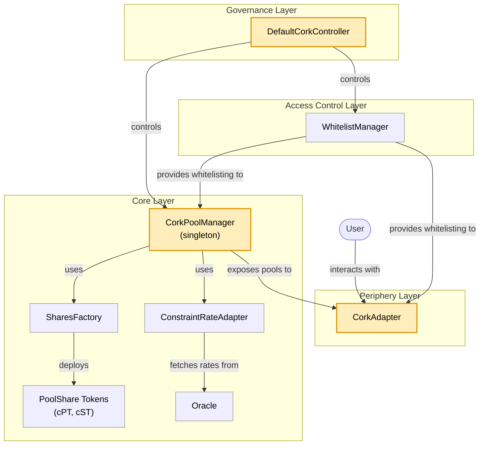

# Cork Phoenix 

Cork is a programmable risk layer for on-chain assets such as vault tokens, yield-bearing stablecoins, and liquid (re)staking tokens.

## Version and compatibility

This tree is labelled **1.4.0-rc.1**. It is **not ABI-compatible with 1.3.0-rc.1**: market tuples and pool identifiers include immutable creation-time fees; fee setters and their events are removed. Regenerate bindings and indexer event signatures rather than treating this as a drop-in upgrade. See the [changelog](CHANGELOG.md) for migration details.

The package version identifies this source tree; contracts do not expose a component `version()` getter. EIP-712 domain version `1` is a separate signing identifier. No deployment equivalence or audit status is implied by the package label.

## Table of Contents

- [Glossary](#glossary)
- [Architecture](#architecture)
- [Smart Contracts](#smart-contracts)
- [Deployment Addresses](#deployment-addresses)
- [Setup](#setup)
- [Testing](#testing)
- [Standards & Frameworks](#standards--frameworks)
- [Audits](#audits)
- [Security](#security)
- [License](#license)
- [Resources](#resources)
- [Inspirations & Sources](#inspirations--sources)
- [Useful Links](#useful-links)

## Glossary

- CA = Collateral Asset,
- REF = Reference Asset,
- cPT = Cork Principal Token,
- cST = Cork Swap Token

## Architecture

Cork Phoenix uses a singleton-style architecture where all pool states are managed by [`CorkPoolManager.sol`](./contracts/core/CorkPoolManager.sol). This design enables efficient and secure state management of the system and providing a single source of truth for all Cork Phoenix markets.

### Core Operations

Cork Phoenix provides a comprehensive set of operations for managing positions throughout their lifecycle. All operations are available in [`CorkPoolManager.sol`](./contracts/core/CorkPoolManager.sol).

#### Before Expiry

| Operation | Description | Input Tokens | Output Tokens | Pool Assets |
|-----------|-------------|--------------|---------------|-------------|
| **Deposit / Mint** | Enter a liquidity position to the protocol to receive a swap token. | CA | cPT + cST | CA ↑ |
| **UnwindDeposit / UnwindMint** | Exit a liquidity position, before expiry, to recoup the deposited collateral. | cPT + cST | CA | CA ↓ |
| **Swap / Exercise** | Exercise your coverage to get collateral. | REF + cST | CA - Fee | CA ↓ REF ↑ cST ↑ |
| **UnwindSwap / UnwindExercise** | Purchase previously exercised swap tokens back from the protocol by providing collateral asset. | CA + Fee | REF + cST | CA ↑ REF ↓ cST ↓ |

#### After Expiry

| Operation | Description | Input Tokens | Output Tokens | Pool Assets |
|-----------|-------------|--------------|---------------|-------------|
| **Withdraw / Redeem** | Exit a liquidity position, after expiry, to recoup the deposited collateral. | cPT | CA + REF | CA ↓, REF ↓ |

### Dual Share System

Each pool issues _two_ shares upon deposit: **cPT (Cork Principal Token) and cST (Cork Swap Token)**. This enables users to hold or trade principal and swap exposures separately.

### System Components



### Periphery

It's important to note that while you can interact with `CorkPoolManager` directly, it does not provide slippage and deadline protection out of the box. If slippage is a concern, consider using our periphery adapter ([`CorkAdapter.sol`](./contracts/periphery/CorkAdapter.sol)). This contract is inspired by the Morpho [`GeneralAdapter1`](https://github.com/morpho-org/bundler3/blob/main/src/adapters/GeneralAdapter1.sol) contract. You can use the adapter with the [`bundler3`](https://github.com/morpho-org/bundler3/blob/main/README.md) contract similar to how you would normally use the Morpho adapter with multicall, but tailored specifically to Cork's adapter.

## Smart Contracts

### Core Contracts

| Contract | Role | Key Responsibilities |
|----------|------|---------------------|
| **CorkPoolManager** | Singleton pool management | Pool creation, deposits/mints, withdrawals/redemptions, swaps/exercise, and their unwind operations |
| **DefaultCorkController** | Protocol governance & administration | Pool authorization (fees are set once at pool creation and cannot change), pause controls, whitelist access management, treasury operations |
| **WhitelistManager** | Access control management | Global and market-specific whitelisting mechanism |
| **ConstraintRateAdapter** | Rate protection & oracle safety | Rate clamping with configurable constraints, protection against oracle manipulation and extreme volatility |
| **PoolShare** | Token implementation | ERC20 tokens (cPT & cST) with EIP-2612 and EIP-7597 (ERC-1271 contract signer) permit support, burnable functionality, and ERC4626 compatibility |
| **SharesFactory** | Token deployment | Deploys cPT and cST token pairs per market with consistent configuration |
| **CorkPoolManagerStorage** | State management | Defines protocol state structures and storage layout |


### Periphery Contracts

| Contract | Role | Key Features |
|----------|------|--------------|
| **CorkAdapter** | Bundler3 integration with user protection | Safe operations with slippage protection, deadline checks, minimum output enforcement, and whitelist validation. Provides protected versions of all core operations (mint, deposit, withdraw, swap, exercise, redeem, and unwinds). |
| **WrapperRateConsumer** | Rate oracle wrapper | Wraps MorphoChainlinkOracleV2 to provide normalized exchange rates between base and quote tokens with decimal adjustment |

### Interfaces

All interfaces are located in [this folder](contracts/interfaces/)

## Deployment Addresses

The build configuration supports the [Safe Singleton Factory](https://github.com/safe-global/safe-singleton-factory). A deterministic deployment mechanism alone does not prove that addresses or runtime bytecode match across chains.

Per-version deployment records belong in this repository's [Releases](https://github.com/Cork-Technology/phoenix/releases); consult [docs.cork.tech](https://docs.cork.tech/) for the current living set. `main` is the stable source branch and candidates use `release/*`. A GitHub pre-release flag is not an audit or production-readiness certification. Use the exact version and chain record applicable to your integration.

### External Dependencies

| Contract | Address |
|----------|:-------:|
| Permit2  | [`0x000000000022D473030F116dDEE9F6B43aC78BA3`](https://www.blockscout.com/search?q=0x000000000022D473030F116dDEE9F6B43aC78BA3) |
| Morpho Bundler3 | See [Morpho Addresses](https://docs.morpho.org/get-started/resources/addresses/#bundlers) |

> **Note**: For Sepolia testnet, Bundler3 is deployed at `0xd43EB38E260bF2d6c9B3222559842686B1C303C0`

## Setup

Requires [Foundry](https://getfoundry.sh/).

```
git clone --branch v1.4.0-rc.1 --recurse-submodules https://github.com/Cork-Technology/phoenix.git
cd phoenix
forge build
forge test
```

Dependency revisions are pinned in [foundry.lock](foundry.lock). The smoke tests are skipped unless `SMOKE_CONFIG_PATH` names a populated configuration and need an RPC endpoint — see the [smoke configuration guide](config/smoke/README.md). Run the production profile with `FOUNDRY_PROFILE=production forge test`.

The production profile compiles Phoenix and its test harnesses via IR. The pinned Safe implementation and fallback handler used by permit tests are compiled separately without IR because their assembly does not compile under the selected via-IR pipeline. Tests deploy those real artifacts through ABI-only interfaces; no Safe mock or skipped permit coverage is substituted. Build artifact directories have read-only test permissions.

## Testing

Cork Phoenix employs a comprehensive multi-layered testing approach to ensure protocol security and correctness.

### Test Structure

```
test/forge/
├── unit/          # Isolated tests for libraries and individual contracts
├── integration/   # End-to-end workflow tests across multiple contracts
├── invariant/     # Stateful fuzzing of protocol invariants
├── libraries/     # Library-level tests
├── smoke/         # Tests contract functions against on-chain data
├── helpers/       # Test helper contracts
└── mocks/         # Mock contracts for testing
```

- **Unit Tests**: Isolated testing of libraries and individual contract functions
- **Integration Tests**: End-to-end workflows testing interactions between multiple contracts
- **Fuzz Tests**: Property-based testing using Foundry's fuzzing engine for edge cases, decimals, and rounding
- **Invariant Tests**: Stateful fuzzing that asserts protocol invariants hold across arbitrary call sequences
- **Smoke Tests**: Contract function validation against on-chain data

## Standards & Frameworks

### OpenZeppelin Contracts

Cork Phoenix builds on OpenZeppelin's battle-tested security standards to ensure robust access control, upgradeability, and protection against common attack vectors. We implement **ERC-7201** namespaced storage layout for future-proof upgradeable contracts and use the UUPS proxy pattern for gas-efficient upgrades while maintaining security through role-based access control.

### ERC4626 Tokenized Vault Standard

While Cork implements ERC4626-compatible interfaces for familiarity, we extend beyond the standard with a **dual token system** (cPT + cST) that separates principal protection from swap exposure. This architectural choice enables users to independently hold or trade their cPT and cST tokens, a key differentiator from traditional single-share vault designs.

### Morpho Bundler3

Cork integrates Morpho's bundler3 framework to enable **atomic multi-operation transactions**. This allows users to compose complex workflows (e.g., deposit + swap + exercise) in a single transaction, significantly improving UX and reducing gas costs. Our `CorkAdapter.sol` extends Morpho's `GeneralAdapter1` with Cork-specific safety checks including slippage protection and deadline enforcement.

### Uniswap Permit2

We leverage Permit2 for **signature-based token approvals**, eliminating the need for separate approval transactions. This reduces friction for users and enables gas-efficient batch operations—critical for a protocol where users frequently interact with multiple tokens (REF, CA, cPT, cST) across different operations.

## Audits

Review claims apply only to the source and deployment scope identified by their reports. This source snapshot includes no audit report establishing that its changes are audited and remediated; see [SECURITY.md](SECURITY.md).

## Security

For security policies and vulnerability disclosure see [SECURITY.md](SECURITY.md).

## License

See the [LICENSE](LICENSE) file for details. Individual contracts may have specific license specifications.

## Resources

[Developer documentation](https://docs.cork.tech/)

## Inspirations & Sources

**Morpho Bundler3** ([GitHub](https://github.com/morpho-org/bundler3))
- Transaction batching framework for atomic multi-step operations
- Source: `GeneralAdapter1.sol` adapted from Morpho's bundler3
- Purpose: Gas optimization and improved UX through operation bundling

**Uniswap Permit2** ([GitHub](https://github.com/Uniswap/permit2))
- Signature-based approvals for gas-efficient token transfers
- Batch approval capabilities
- Integration in periphery adapters

**OpenZeppelin Contracts**
- Security patterns: AccessControl, Pausable, ReentrancyGuard
- Upgradeable proxy infrastructure: UUPS, ERC1967Proxy
- Token standards: ERC20, ERC20Permit (EIP-2612)
- Libraries: Math, SafeERC20, SafeCast

**Chainlink Oracles**
- `MinimalAggregatorV3Interface` inspired by Chainlink's AggregatorV3Interface
- Price feed integration for external rate data

**ERC4626 Tokenized Vault Standard**
- Partial compatibility for deposit/withdraw/redeem operations
- Deviation: Dual token system instead of single share token
- Additional swap/exercise functionality beyond ERC4626 scope

## Useful Links

- [Cork Documentation](https://docs.cork.tech/)
- [Cork Phoenix Litepaper](https://corkfi.notion.site/cork-litepaper)